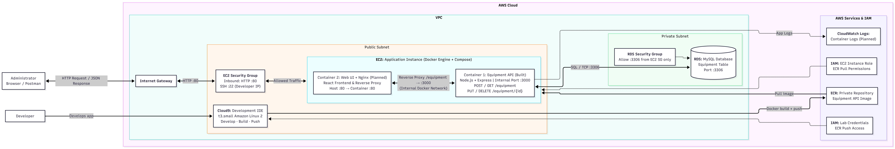

# University Equipment Management System

A containerized web application designed for university administrators to register university-owned equipment, track availability statuses (`AVAILABLE`, `BORROWED`, `MAINTENANCE`, `DAMAGED`), and manage borrowing assignments.

## Architecture (AWS Track B: Containers)

* **VPC & Networking:** Public subnet (Internet Gateway) for the application host and an isolated private subnet for the database.
* **Amazon EC2 (Public Subnet):** Runs Docker Engine and Docker Compose to orchestrate two containers on a shared internal Docker network:
  * **Container 1 (`equipment-api`):** Node.js and Express REST API listening on internal port `3000` (not exposed publicly). Handles CRUD operations, validation, and borrowing rules.
  * **Container 2 (`web-ui`):** Nginx reverse proxy on `Host :80 -> Container :80`, serving the React administrator dashboard and proxying `/equipment` and `/health` requests to `equipment-api:3000`.
* **Amazon RDS (Private Subnet):** Managed MySQL database storing equipment and current borrower records, restricted to inbound TCP `3306` from the EC2 Security Group only.
* **Amazon ECR:** Private container repository storing the `equipment-api` Docker image.
* **Amazon CloudWatch Logs:** Collects container logs for monitoring and troubleshooting.



## Repository Structure

```text
university-equipment-management/
├── api/
│   ├── src/
│   │   ├── db.js            # MySQL connection pool & schema init
│   │   └── index.js         # Express REST API endpoints
│   ├── .env.example         # Environment variable template
│   ├── Dockerfile           # Container image definition for Equipment API
│   └── package.json
├── web/
│   ├── nginx.conf           # Nginx reverse proxy configuration
│   └── README.md            # Web UI implementation notes
├── docs/
│   ├── architecture.jpg     # AWS architecture diagram
│   └── deployment-plan.md   # Step-by-step AWS provisioning & deployment guide
├── docker-compose.yml       # Multi-container service definition
├── .gitignore
└── README.md
```

## Data Entity (`equipment`)

| Attribute | Type | Constraints / Notes |
| :--- | :--- | :--- |
| `equipmentId` | `VARCHAR(50)` | Primary Key |
| `equipmentName` | `VARCHAR(150)` | Required |
| `category` | `VARCHAR(100)` | Required |
| `brand` | `VARCHAR(100)` | Required |
| `availability` | `ENUM` | `AVAILABLE`, `BORROWED`, `MAINTENANCE`, `DAMAGED` |
| `borrowerName` | `VARCHAR(150)` | Nullable (cleared when returned) |
| `borrowerId` | `VARCHAR(50)` | Nullable (cleared when returned) |
| `borrowDate` | `DATETIME` | Nullable |
| `dueDate` | `DATETIME` | Nullable |
| `createdAt` | `DATETIME` | Auto-generated |
| `updatedAt` | `DATETIME` | Auto-updated |

## API Endpoints

| Method | Endpoint | Operation | Description |
| :--- | :--- | :--- | :--- |
| `GET` | `/health` | Health Check | Verifies API and Amazon RDS MySQL connectivity |
| `POST` | `/equipment` | Create | Registers new equipment in the system |
| `GET` | `/equipment` | Read | Retrieves all equipment records |
| `PUT` | `/equipment/:equipmentId` | Update | Updates equipment details, availability, or borrower info |
| `DELETE` | `/equipment/:equipmentId` | Delete | Removes an equipment record |